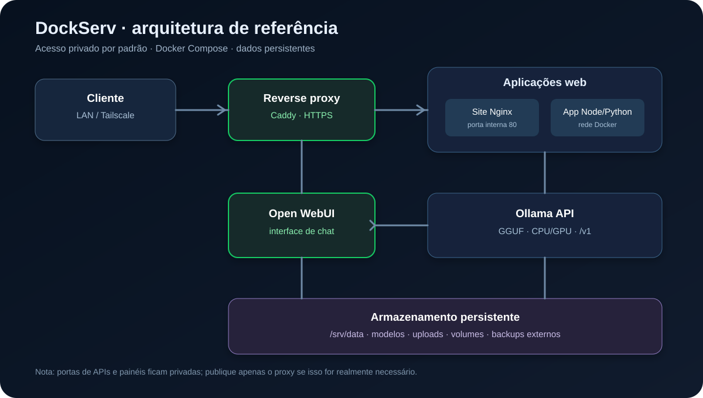

<!--
  DockServ — guia de homelab open-source.
  Imagem local do diagrama: docs/images/arquitetura.svg
-->

<div align="center">

# DockServ — Homelab com Ubuntu Server, Docker e IA local

**Um guia prático para hospedar modelos GGUF, sites, aplicações e arquivos com foco em segurança.**


</div>

> **Antes de começar — ambiente ainda não informado:** este guia usa um perfil de referência, não uma afirmação sobre o hardware real do operador. Ajuste-o após conferir CPU, RAM, GPU, discos e rede.

| Campo | Perfil de referência / decisão |
|---|---|
| Hardware | **A confirmar**. Exemplo viável: CPU x86-64 com 6+ núcleos, 16–32 GB RAM; NVIDIA com 8–12 GB VRAM ajuda, mas não é obrigatória. |
| Armazenamento | **A confirmar**. Recomendado: SSD para SO/containers e disco dedicado para modelos/dados; planeje espaço para backups. |
| Rede | Roteador doméstico; IP LAN reservado no DHCP. Não presumir IP público. |
| Experiência | Intermediário em Linux; Docker básico. |
| Acesso | LAN + Tailscale para acesso remoto, sem encaminhamento de portas no roteador. |

## Visão geral



A implantação mantém APIs e painéis privados. O reverse proxy é opcional para aplicações web; Tailscale fornece acesso remoto sem abrir portas de entrada no roteador.

## 0. Dimensionamento: escolha o modelo antes de baixar

| Recursos disponíveis | Expectativa realista |
|---|---|
| 8 GB RAM, sem GPU | Modelos pequenos (1–3B) em Q4; desempenho e contexto limitados. Evite hospedar muitos serviços ao mesmo tempo. |
| 16 GB RAM, sem GPU | 3–8B quantizado pode funcionar, dependendo do contexto e do SO; espere inferência mais lenta. |
| 32 GB RAM, sem GPU | 7–14B quantizado pode ser possível; RAM/contexto e velocidade variam bastante. |
| GPU NVIDIA 8 GB VRAM | Modelos pequenos/médios parcialmente ou totalmente offloaded, conforme quantização e contexto. |
| GPU NVIDIA 12–16 GB VRAM | Mais margem para 7–14B quantizados, mas pesos, KV cache e contexto consomem VRAM. |
| 64 GB+ RAM / GPU maior | Mais margem para modelos maiores e múltiplos serviços. |

**Regra:** o tamanho do arquivo GGUF não é o único consumo. KV cache, contexto, buffers, runtime e sistema operacional também usam memória. Comece com contexto moderado e um único modelo.

---

## 1. Preparação do Ubuntu Server

### 1.1 Versão e instalação

Recomendação conservadora: **Ubuntu Server 24.04 LTS** com atualizações de segurança. É uma base LTS madura e amplamente suportada por drivers e containers. Antes de produção, confira a página oficial para atualizações de point release e requisitos: [Ubuntu Server](https://ubuntu.com/download/server).

Durante a instalação:
1. Selecione idioma, teclado, rede e fuso horário.
2. Configure um usuário administrativo comum (não trabalhe diariamente como root).
3. Marque **Install OpenSSH server**.
4. Use disco/particionamento adequado; se possível, mantenha dados e backups separados do sistema.
5. Instale atualizações e reinicie.

Após iniciar sessão localmente:

```bash
# Atualize o sistema
sudo apt update
sudo apt full-upgrade -y
sudo reboot
```

Depois, descubra o IP LAN e reserve-o no DHCP do roteador:

```bash
hostnamectl
ip -brief address
ip route
lsblk -o NAME,SIZE,FSTYPE,MOUNTPOINTS
free -h
nproc
```

### 1.2 SSH com chave

No computador cliente, gere uma chave (se ainda não tiver):

```bash
ssh-keygen -t ed25519 -a 64
ssh-copy-id usuario@IP_DO_SERVIDOR
ssh usuario@IP_DO_SERVIDOR
```

Em alguns clientes Windows, use o OpenSSH do PowerShell e copie a chave pública manualmente se `ssh-copy-id` não estiver disponível. Confirme que o login por chave funciona **antes** de desativar senha.

Crie uma configuração dedicada:

```bash
sudo install -d -m 0755 /etc/ssh/sshd_config.d
sudo tee /etc/ssh/sshd_config.d/10-hardening.conf >/dev/null <<'EOF'
PubkeyAuthentication yes
PermitRootLogin no
# Descomente somente após validar o acesso por chave em outra sessão:
# PasswordAuthentication no
EOF
sudo sshd -t && sudo systemctl reload ssh
```

**Risco:** desativar autenticação por senha antes de confirmar a chave pode bloquear seu acesso remoto. Mantenha uma sessão ativa e acesso físico/console disponível durante a mudança.

### 1.3 Firewall UFW

Permita SSH antes de habilitar o firewall:

```bash
sudo apt install -y ufw
sudo ufw default deny incoming
sudo ufw default allow outgoing
sudo ufw allow OpenSSH
sudo ufw enable
sudo ufw status verbose
```

Não abra portas para Ollama (11434), Open WebUI (3000), Portainer (9443), File Browser (8080) ou bancos de dados na internet. Se futuramente publicar um site diretamente, abra apenas 80/443 conscientemente; a recomendação deste guia é manter acesso privado via Tailscale.

### 1.4 Swappiness, limites e atualizações

Crie ajustes moderados, observando o comportamento real. Swappiness não é uma regra universal; em servidor com pouca RAM, swap pode evitar encerramentos abruptos, mas não torna inferência lenta rápida.

```bash
# Consulte o valor atual
cat /proc/sys/vm/swappiness

# Ajuste conservador e persistente
echo 'vm.swappiness=10' | sudo tee /etc/sysctl.d/99-homelab.conf
sudo sysctl --system

# Limites de arquivos por serviço devem ser configurados no systemd/container
# quando houver necessidade comprovada; não altere ulimit global às cegas.
ulimit -n
```

Ative atualizações de segurança automáticas:

```bash
sudo apt install -y unattended-upgrades
sudo dpkg-reconfigure -plow unattended-upgrades
systemctl status unattended-upgrades --no-pager
```

Programe uma janela de manutenção para reinícios após atualizações de kernel. Não faça upgrade de versão principal sem backup testado.

---

## 2. Instalação do Docker Engine e Docker Compose

Use o **repositório oficial do Docker**, não o pacote `docker.io` do repositório Ubuntu. Instruções oficiais podem mudar; confira [Docker Engine para Ubuntu](https://docs.docker.com/engine/install/ubuntu/).

```bash
# Remova pacotes conflitantes, se existirem
sudo apt remove -y docker.io docker-doc docker-compose podman-docker containerd runc

# Dependências e chave oficial
sudo apt update
sudo apt install -y ca-certificates curl
sudo install -m 0755 -d /etc/apt/keyrings
sudo curl -fsSL https://download.docker.com/linux/ubuntu/gpg -o /etc/apt/keyrings/docker.asc
sudo chmod a+r /etc/apt/keyrings/docker.asc

# Repositório para a versão Ubuntu instalada
echo "deb [arch=$(dpkg --print-architecture) signed-by=/etc/apt/keyrings/docker.asc] https://download.docker.com/linux/ubuntu $(. /etc/os-release && echo ${UBUNTU_CODENAME:-$VERSION_CODENAME}) stable" | sudo tee /etc/apt/sources.list.d/docker.list >/dev/null

sudo apt update
sudo apt install -y docker-ce docker-ce-cli containerd.io docker-buildx-plugin docker-compose-plugin
sudo systemctl enable --now docker
docker --version
docker compose version
sudo docker run --rm hello-world
```

### Grupo docker e segurança

```bash
# Conveniência: permite executar Docker sem sudo
sudo usermod -aG docker "$USER"
# Saia e entre novamente (ou abra uma nova sessão) para o grupo ser aplicado
```

**Atenção:** o grupo `docker` equivale, na prática, a privilégios de root. Adicione apenas contas administrativas confiáveis. Em ambiente multiusuário, mantenha `sudo docker` ou avalie Docker rootless.

Configure rotação de logs para não encher o disco:

```bash
sudo install -d /etc/docker
sudo tee /etc/docker/daemon.json >/dev/null <<'EOF'
{
  "log-driver": "json-file",
  "log-opts": {
    "max-size": "10m",
    "max-file": "3"
  }
}
EOF
sudo systemctl restart docker
```

Não exponha o socket `/var/run/docker.sock` por TCP nem o monte em aplicações web sem necessidade: acesso ao socket permite controlar containers e pode levar ao controle do host. Use imagens confiáveis, tags fixas, volumes mínimos e atualizações deliberadas.

### 2.1 NVIDIA Container Toolkit (somente se houver GPU NVIDIA compatível)

Instale primeiro o driver NVIDIA recomendado para Ubuntu e confirme `nvidia-smi` no host. Depois siga as instruções atuais do fornecedor: [NVIDIA Container Toolkit — instalação](https://docs.nvidia.com/datacenter/cloud-native/container-toolkit/latest/install-guide.html).

Após configurar o repositório e instalar o toolkit conforme a documentação oficial:

```bash
sudo nvidia-ctk runtime configure --runtime=docker
sudo systemctl restart docker

# Teste: use uma tag CUDA compatível publicada oficialmente
sudo docker run --rm --gpus all nvidia/cuda:12.9.1-base-ubuntu24.04 nvidia-smi
```

Se a tag de teste não estiver disponível ou não for compatível com o driver, selecione uma imagem CUDA oficial suportada pelo seu driver. **Não instale drivers aleatórios nem misture repositórios de distribuições diferentes.** Sem GPU NVIDIA, pule esta seção.

---

## 3. Estrutura de diretórios e permissões

Use `/srv` para dados de serviços e monte o disco de dados por UUID antes de colocar modelos grandes nele. O exemplo abaixo usa um único volume; adapte o ponto de montagem ao seu layout.

```bash
sudo mkdir -p /srv/dockserv/{compose,config,backups}
sudo mkdir -p /srv/data/{ollama,open-webui,sites,apps,files,models}
sudo mkdir -p /srv/data/sites/exemplo
sudo chown -R "$USER":docker /srv/dockserv /srv/data
sudo chmod -R 0750 /srv/dockserv /srv/data
```

Árvore sugerida:

```text
/srv/
├── dockserv/
│   ├── compose/       # compose.yaml e arquivos .env
│   ├── config/        # configurações de proxy/serviços
│   └── backups/       # staging temporário de backup
└── data/
    ├── ollama/        # pesos/modelos baixados pelo Ollama
    ├── open-webui/    # banco e dados da interface
    ├── models/        # GGUF originais/importados
    ├── sites/         # conteúdo estático
    ├── apps/          # dados persistentes das aplicações
    └── files/         # área para compartilhamento
```

Os processos em containers podem usar UIDs/GIDs diferentes. Ajuste ownership por serviço quando necessário; evite `chmod -R 777`. Para dados sensíveis, use permissões restritas e criptografia de disco quando apropriado.

### Montar disco de dados por UUID (opcional)

```bash
lsblk -f
sudo blkid
# Edite /etc/fstab usando o UUID real e o filesystem correto.
# Exemplo ext4 (substitua UUID_REAL):
# UUID=UUID_REAL /srv/data ext4 defaults,noatime 0 2
sudo mount -a
findmnt /srv/data
```

**Não copie a linha de exemplo com UUID fictício para produção.** Teste `mount -a` antes de reiniciar.

---

## 4. Executar modelos GGUF com Ollama

### 4.1 O que é GGUF e quantização?

GGUF é um formato de arquivo usado por runtimes como llama.cpp. Ollama gerencia modelos e também pode importar um GGUF local usando um `Modelfile`.

- **Q4_K_M:** normalmente reduz bastante o tamanho e é um bom ponto de partida para memória limitada, com alguma perda de qualidade em relação a precisões maiores.
- **Q5_K_M:** costuma ocupar mais memória e preservar um pouco mais de qualidade, mas o ganho depende do modelo e da tarefa.
- A quantização não é uma garantia de qualidade; confira licença, origem, contexto e requisitos do modelo. Baixe apenas de fontes confiáveis.

### 4.2 Compose do Ollama (CPU por padrão)

Crie `/srv/dockserv/compose/ollama/compose.yaml`:

```bash
mkdir -p /srv/dockserv/compose/ollama
```

```yaml
services:
  ollama:
    image: ollama/ollama:0.11.10
    container_name: ollama
    restart: unless-stopped
    environment:
      # Limita concorrência. Ajuste conforme RAM e carga.
      OLLAMA_NUM_PARALLEL: "1"
      OLLAMA_MAX_LOADED_MODELS: "1"
      OLLAMA_KEEP_ALIVE: "5m"
    volumes:
      - /srv/data/ollama:/root/.ollama
    # Só o host local acessa a API; containers na rede usam http://ollama:11434.
    ports:
      - "127.0.0.1:11434:11434"
    networks:
      - ai-internal
    security_opt:
      - no-new-privileges:true

networks:
  ai-internal:
    name: dockserv-ai
```

> A tag é fixada para tornar o exemplo reproduzível. Antes de instalar, confira a existência da tag e a release atual no [repositório oficial Ollama](https://hub.docker.com/r/ollama/ollama); atualize conscientemente em vez de usar `latest` em produção.

Inicie e baixe um modelo de acordo com seu hardware:

```bash
cd /srv/dockserv/compose/ollama
docker compose up -d
docker compose logs -f ollama

# Exemplo pequeno para começar; confira tamanho/licença antes de baixar
docker exec -it ollama ollama pull qwen2.5:3b
# Alternativa maior, somente se houver memória suficiente:
# docker exec -it ollama ollama pull qwen2.5:7b

docker exec ollama ollama list
```

Os nomes disponíveis mudam; confira o catálogo em [Ollama Library](https://ollama.com/library). Baixar um modelo consome armazenamento e rede. O volume em `/srv/data/ollama` mantém os modelos após recriação do container.

### 4.3 Ativar GPU NVIDIA no Compose

Faça uma cópia de segurança do Compose e adicione ao serviço `ollama` o bloco abaixo se sua instalação Docker/Compose e NVIDIA Container Toolkit suportarem a reserva de dispositivo:

```yaml
    # Dentro de services.ollama:
    deploy:
      resources:
        reservations:
          devices:
            - driver: nvidia
              count: all
              capabilities: [gpu]
```

Depois:

```bash
docker compose up -d --force-recreate
docker logs ollama
```

Sem GPU, não adicione o bloco. O runtime escolhe o offload disponível; não há uma variável universal que force todos os modelos a caber em VRAM. Controle a concorrência e o contexto, monitore `nvidia-smi`, `free -h` e `docker stats`. `OLLAMA_NUM_PARALLEL` e `OLLAMA_MAX_LOADED_MODELS` ajudam a limitar concorrência/modelos residentes, mas não substituem dimensionamento.

### 4.4 Importar um GGUF baixado do Hugging Face

Use apenas um arquivo GGUF de repositório confiável e respeite a licença do modelo. Exemplo de download com Git LFS:

```bash
sudo apt install -y git git-lfs
git lfs install
# Substitua pelo repositório e arquivo GGUF que você verificou.
cd /srv/data/models
git clone https://huggingface.co/ORGANIZACAO/REPOSITORIO
find /srv/data/models -type f -iname '*.gguf'
```

Alguns repositórios grandes oferecem múltiplos shards; baixe todos os arquivos exigidos pelo modelo. Alternativamente, use o CLI oficial `hf` em ambiente Python isolado e leia a documentação do repositório. Evite colar tokens de acesso em comandos que ficam no histórico.

Ollama precisa conseguir ler o GGUF. Copie o arquivo escolhido para um diretório de importação e monte-o somente leitura:

```bash
mkdir -p /srv/data/models/import
# Copie seu GGUF para este diretório e ajuste permissões:
chmod 0640 /srv/data/models/import/*.gguf
```

Adicione ao serviço Ollama um volume somente leitura (mantenha também o volume de dados original):

```yaml
    volumes:
      - /srv/data/ollama:/root/.ollama
      - /srv/data/models/import:/models:ro
```

Recrie o container e crie um Modelfile:

```bash
docker compose up -d
cat > /srv/data/models/import/Modelfile <<'EOF'
FROM /models/meu-modelo.gguf
# Opcional: ajuste somente parâmetros documentados para o modelo.
# PARAMETER num_ctx 4096
EOF

docker exec -it ollama ollama create meu-modelo-local -f /models/Modelfile
docker exec -it ollama ollama run meu-modelo-local
```

Troque `meu-modelo.gguf` pelo nome real. Se o modelo exigir tokenizer, template ou arquivos auxiliares, siga as instruções do repositório original. Ollama pode não aceitar qualquer pacote de modelo; valide formato e metadados.

### 4.5 API compatível com OpenAI

Ollama fornece endpoints compatíveis em `/v1`. Como a porta foi vinculada a `127.0.0.1`, teste no próprio servidor:

```bash
curl http://127.0.0.1:11434/v1/chat/completions \
  -H 'Content-Type: application/json' \
  -d '{
    "model": "qwen2.5:3b",
    "messages": [
      {"role": "system", "content": "Responda em português de forma clara."},
      {"role": "user", "content": "Explique o que é Docker em duas frases."}
    ],
    "stream": false
  }'
```

Liste modelos:

```bash
curl http://127.0.0.1:11434/v1/models
```

Para SDKs OpenAI-compatible, use base URL `http://127.0.0.1:11434/v1` no host e uma API key placeholder se o cliente exigir; a API local não deve ser considerada protegida por autenticação neste setup. **Não publique a porta 11434 na LAN ou internet.** Se outro container precisar acessar Ollama, conecte-o à rede Docker apropriada e use `http://ollama:11434`.

---

## 5. Interface web: Open WebUI

Crie `/srv/dockserv/compose/open-webui/compose.yaml`:

```bash
mkdir -p /srv/dockserv/compose/open-webui
```

```yaml
services:
  open-webui:
    image: ghcr.io/open-webui/open-webui:v0.6.18
    container_name: open-webui
    restart: unless-stopped
    environment:
      OLLAMA_BASE_URL: http://ollama:11434
    volumes:
      - /srv/data/open-webui:/app/backend/data
    ports:
      - "127.0.0.1:3000:8080"
    networks:
      - dockserv-ai
    security_opt:
      - no-new-privileges:true

networks:
  dockserv-ai:
    external: true
```

A rede `dockserv-ai` é criada pelo Compose do Ollama. Inicie primeiro o Ollama. Confira tags atuais no [Open WebUI](https://github.com/open-webui/open-webui/releases) e substitua a tag fixa por uma versão validada.

```bash
cd /srv/dockserv/compose/open-webui
docker compose up -d
docker compose logs -f open-webui
```

Acesse no próprio servidor em `http://127.0.0.1:3000`. De outro computador, use um túnel SSH:

```bash
ssh -L 3000:127.0.0.1:3000 usuario@IP_DO_SERVIDOR
```

Então abra `http://127.0.0.1:3000` no computador cliente.

**Por que localhost?** O bind `127.0.0.1` impede que a porta seja publicada diretamente na interface LAN. Docker ainda permite tráfego interno entre containers na rede comum. Se mudar o bind para `0.0.0.0`, entenda a exposição e restrinja no firewall/proxy.

---

## 6. Hospedagem de sites e aplicações

### 6.1 Site estático com Nginx

```bash
mkdir -p /srv/data/sites/exemplo /srv/dockserv/compose/site
cat > /srv/data/sites/exemplo/index.html <<'EOF'
<!doctype html>
<html lang="pt-BR">
<head><meta charset="utf-8"><meta name="viewport" content="width=device-width,initial-scale=1">
<title>DockServ</title></head>
<body><h1>Meu homelab está funcionando</h1><p>Site estático servido por Nginx.</p></body>
</html>
EOF
```

Crie `/srv/dockserv/compose/site/compose.yaml`:

```yaml
services:
  site:
    image: nginx:1.28-alpine
    container_name: dockserv-site
    restart: unless-stopped
    volumes:
      - /srv/data/sites/exemplo:/usr/share/nginx/html:ro
    ports:
      - "127.0.0.1:8081:80"
    security_opt:
      - no-new-privileges:true
```

```bash
cd /srv/dockserv/compose/site
docker compose up -d
curl -I http://127.0.0.1:8081
```

### 6.2 Aplicação dinâmica Node.js (exemplo mínimo)

```bash
mkdir -p /srv/dockserv/compose/node-app
cd /srv/dockserv/compose/node-app
cat > package.json <<'EOF'
{"name":"dockserv-demo","version":"1.0.0","private":true,"scripts":{"start":"node server.js"},"dependencies":{"express":"4.21.2"}}
EOF
cat > server.js <<'EOF'
const express = require("express");
const app = express();
app.get("/", (_req, res) => res.json({ status: "ok", service: "dockserv-node" }));
app.listen(3000, "0.0.0.0", () => console.log("App na porta 3000"));
EOF
cat > Dockerfile <<'EOF'
FROM node:22-alpine
ENV NODE_ENV=production
WORKDIR /app
COPY package.json ./
RUN npm install --omit=dev && npm cache clean --force
COPY server.js ./
USER node
EXPOSE 3000
CMD ["npm", "start"]
EOF
cat > compose.yaml <<'EOF'
services:
  app:
    build: .
    container_name: dockserv-node
    restart: unless-stopped
    ports:
      - "127.0.0.1:3002:3000"
    read_only: true
    tmpfs:
      - /tmp
    security_opt:
      - no-new-privileges:true
EOF
docker compose up -d --build
curl http://127.0.0.1:3002
```

Para produção, fixe imagens por tag e, quando apropriado, digest; use lockfile (`package-lock.json`), usuário sem privilégios, varredura de dependências e healthcheck. Não coloque segredos no Dockerfile ou Git. Apps Python seguem o mesmo padrão: dependências fixadas em `requirements.txt`, imagem Python com tag fixa e processo não-root.

### 6.3 Reverse proxy e HTTPS

**Caddy** simplifica HTTPS quando o domínio aponta para o servidor e as portas necessárias são alcançáveis. Para nomes apenas locais, certificados públicos ACME geralmente não funcionam sem domínio validável. Alternativas:
- Tailscale Serve para HTTPS privado em dispositivos da tailnet.
- Caddy com uma CA interna (`tls internal`), instalando a CA nos clientes confiáveis.
- Domínio próprio e DNS/ACME apropriado, se decidir publicar um site de verdade.

Exemplo de Caddyfile para uso interno:

```text
site.home.arpa {
    reverse_proxy 127.0.0.1:8081
    tls internal
}
app.home.arpa {
    reverse_proxy 127.0.0.1:3002
    tls internal
}
```

Um proxy em container não pode usar `127.0.0.1:8081` do host como se fosse o host. Para proxy containerizado, conecte proxy e apps a uma rede Docker comum e use nomes de serviço, por exemplo `reverse_proxy site:80`. Não publique portas dos backends; publique apenas 80/443 no proxy, e somente na interface necessária. Configure DNS local (roteador, Pi-hole ou hosts) para os nomes internos.

Não configure certificados públicos para nomes fictícios `.home.arpa`. Não abra portas no roteador só para obter HTTPS local.

### 6.4 Persistência e backups

- Guarde arquivos importantes em bind mounts sob `/srv/data`, não somente na camada gravável do container.
- Versione Compose e configurações sem segredos.
- Faça backup consistente de bancos de dados (dump nativo) antes de arquivar volumes ativos.
- Mantenha pelo menos uma cópia em disco externo desconectado ou em outro destino confiável.
- Teste restauração; backup nunca testado não é garantia.

---

## 7. Armazenamento e compartilhamento seguro

### 7.1 File Browser para uma pasta privada

File Browser é simples para uma pasta de arquivos. Para o exemplo, deixe o painel apenas em localhost e use Tailscale/túnel SSH para acessar. Verifique a tag disponível no [projeto oficial](https://github.com/filebrowser/filebrowser/releases) antes de produção.

```bash
mkdir -p /srv/dockserv/compose/filebrowser /srv/data/files /srv/dockserv/config
sudo touch /srv/dockserv/config/filebrowser.db /srv/dockserv/config/filebrowser.json
sudo chown -R 1000:1000 /srv/dockserv/config /srv/data/files
```

`/srv/dockserv/compose/filebrowser/compose.yaml`:

```yaml
services:
  filebrowser:
    image: filebrowser/filebrowser:v2.32.0
    container_name: dockserv-filebrowser
    restart: unless-stopped
    user: "1000:1000"
    volumes:
      - /srv/data/files:/srv
      - /srv/dockserv/config/filebrowser.db:/database/filebrowser.db
      - /srv/dockserv/config/filebrowser.json:/config/settings.json
    ports:
      - "127.0.0.1:8080:80"
    security_opt:
      - no-new-privileges:true
```

```bash
cd /srv/dockserv/compose/filebrowser
docker compose up -d
docker compose logs -f filebrowser
```

A configuração inicial varia por versão; siga a documentação oficial para criar uma conta administrativa com senha forte e verificar caminhos suportados. **Não assuma credenciais padrão e não publique o painel antes de configurar credenciais.** Se o bind mount de configuração não for compatível com a tag selecionada, ajuste conforme a documentação da release.

### 7.2 Alternativa: Nextcloud

Nextcloud é mais completo (usuários, sincronização, compartilhamento, apps), mas consome mais recursos e requer banco de dados, cron e atualizações coordenadas. Use o Compose oficial/recomendado da documentação Nextcloud, fixe tags e persista tanto dados quanto banco. Não exponha Nextcloud sem HTTPS, atualizações, autenticação forte e política de backup. Para um homelab pequeno, comece com File Browser.

### Servir GGUF grandes

- Mantenha modelos originais em `/srv/data/models`; use volume de importação somente leitura no Ollama.
- Compartilhe apenas a pasta necessária, não `/srv` inteiro nem o diretório de configuração.
- Restrinja usuários e permissões; evite links públicos e URLs previsíveis para arquivos sensíveis.
- Confira checksum e licença. Arquivos GGUF podem ter muitos GB; reserve espaço e monitore `df -h`.
- Não coloque pesos de modelos ou tokens privados no GitHub.

---

## 8. Acesso remoto seguro com Tailscale

Tailscale cria uma rede privada entre dispositivos sem encaminhar portas de entrada no roteador. Consulte o [guia oficial de instalação Linux](https://tailscale.com/kb/1031/install-linux/).

No servidor Ubuntu:

```bash
curl -fsSL https://tailscale.com/install.sh | sh
sudo tailscale up
tailscale status
tailscale ip -4
```

Siga o link de autenticação exibido no terminal. Instale Tailscale no notebook/celular e entre na mesma tailnet. Acesse o servidor pelo IP Tailscale ou nome MagicDNS, por exemplo:

```bash
ssh usuario@NOME-DO-SERVIDOR
```

Para um painel vinculado a localhost, use túnel SSH:

```bash
# No computador cliente, mantém a sessão aberta e encaminha a porta local
ssh -L 3000:127.0.0.1:3000 usuario@NOME-DO-SERVIDOR
# Abra http://127.0.0.1:3000 no cliente
```

Se desejar um endereço HTTPS privado, avalie Tailscale Serve conforme a documentação atual. Não use Funnel para publicar serviços privados sem entender a exposição pública.

### Checklist de segurança

- [ ] Nenhum port-forward no roteador para Ollama, Open WebUI, File Browser, SSH ou Portainer.
- [ ] UFW ativo; SSH permitido apenas conforme sua política.
- [ ] Ollama em `127.0.0.1:11434`; painéis administrativos em localhost ou tailnet.
- [ ] Chaves SSH e senha forte; root login desativado.
- [ ] Tailscale com MFA na conta e controle de acesso restrito.
- [ ] Segredos em arquivo `.env` com permissão `0600`, nunca versionados.
- [ ] Atualizações e backups regulares; volumes e socket Docker não expostos.

---

## 9. Manutenção e monitoramento

### Comandos do dia a dia

```bash
# Containers ativos e todos os containers
docker ps
docker ps -a

# Logs de um serviço
docker logs --tail=200 -f ollama
docker compose -f /srv/dockserv/compose/ollama/compose.yaml logs -f

# Uso de CPU/memória
docker stats

# Espaço em disco e memória
df -h
free -h

# Modelos e teste
docker exec ollama ollama list
curl http://127.0.0.1:11434/v1/models

# Atualizar imagem de forma controlada: revisar release/changelog antes
docker compose -f /srv/dockserv/compose/ollama/compose.yaml pull
docker compose -f /srv/dockserv/compose/ollama/compose.yaml up -d
```

`docker system prune` remove recursos não utilizados. **Não use `docker system prune -a --volumes` como limpeza rotineira:** pode apagar imagens úteis e volumes de dados. Antes de limpar, confira `docker system df` e leia a confirmação.

### Backup automatizado básico

O script abaixo arquiva configurações e dados persistentes; serviços com banco de dados precisam de dumps consistentes. Um tar de diretório de banco em uso pode não ser consistente. Este exemplo também **não inclui os pesos do Ollama nem `/srv/data/models`**, que podem ocupar centenas de GB. Decida se vale incluí-los ou baixá-los novamente.

Crie `/usr/local/sbin/dockserv-backup.sh`:

```bash
sudo tee /usr/local/sbin/dockserv-backup.sh >/dev/null <<'EOF'
#!/usr/bin/env bash
set -Eeuo pipefail
umask 077
DEST="/srv/dockserv/backups"
STAMP="$(date +%F_%H%M%S)"
ARCHIVE="$DEST/dockserv-$STAMP.tar.gz"
mkdir -p "$DEST"
tar --numeric-owner -czf "$ARCHIVE" \
  /srv/dockserv/compose \
  /srv/dockserv/config \
  /srv/data/open-webui \
  /srv/data/sites \
  /srv/data/apps \
  /srv/data/files
find "$DEST" -maxdepth 1 -type f -name 'dockserv-*.tar.gz' -mtime +14 -delete
echo "Backup criado: $ARCHIVE"
EOF
sudo chmod 750 /usr/local/sbin/dockserv-backup.sh
```

Para Ollama, parar brevemente o container durante a cópia pode evitar alterações durante o backup, mas causa indisponibilidade. Se incluir bancos de dados, use dump nativo. Mantenha outra cópia em disco externo desconectado ou em destino confiável, e teste a restauração.

Teste manual:

```bash
sudo /usr/local/sbin/dockserv-backup.sh
sudo ls -lh /srv/dockserv/backups
```

Agende diariamente às 02:30 com cron:

```bash
sudo tee /etc/cron.d/dockserv-backup >/dev/null <<'EOF'
30 2 * * * root /usr/local/sbin/dockserv-backup.sh >> /var/log/dockserv-backup.log 2>&1
EOF
sudo chmod 644 /etc/cron.d/dockserv-backup
```

Garanta que o destino de backup não seja o único disco do servidor. Teste a restauração periodicamente em um diretório temporário.

### Monitoramento

Comece com `docker stats`, `journalctl -p warning`, `df -h` e `nvidia-smi` (se houver GPU). Portainer e Netdata são opcionais; se instalá-los, fixe tags, use autenticação forte e mantenha painéis privados. **Não monte o socket Docker em um painel acessível publicamente.**

---

## 10. Checklist final de validação

- [ ] Ubuntu atualizado, SSH por chave testado e acesso de recuperação disponível.
- [ ] UFW ativo; portas e encaminhamentos revisados.
- [ ] Docker Engine e plugin Compose instalados do repositório oficial.
- [ ] Log rotation configurada; acesso ao grupo Docker restrito.
- [ ] Diretórios persistentes criados com permissões mínimas.
- [ ] Ollama inicia após reboot e lista pelo menos um modelo.
- [ ] `curl http://127.0.0.1:11434/v1/chat/completions` retorna uma resposta.
- [ ] Open WebUI abre via túnel SSH ou rede privada e mantém conversas após recriação.
- [ ] Site Nginx responde em `127.0.0.1:8081`; app Node responde em `127.0.0.1:3002`.
- [ ] File Browser está privado, com credenciais fortes e apenas a pasta de arquivos necessária.
- [ ] Tailscale conecta do celular/notebook fora da rede doméstica.
- [ ] Backup automático gera arquivo, logs são revisados e restauração foi testada.
- [ ] Uso de RAM/VRAM, temperatura, armazenamento e espaço de backup são monitorados.

## Resumo de portas

| Serviço | Porta | Propósito | Exposto publicamente? |
|---|---:|---|---|
| SSH | 22/TCP (padrão) | Administração remota | **Não**; LAN/tailnet conforme firewall |
| Ollama | 11434/TCP | API de inferência / OpenAI-compatible | **Não**; bind localhost |
| Open WebUI | 3000/TCP no host | Interface de chat | **Não**; bind localhost |
| Site Nginx | 8081/TCP no host | Site estático de exemplo | **Não**; bind localhost |
| App Node | 3002/TCP no host | App dinâmico de exemplo | **Não**; bind localhost |
| File Browser | 8080/TCP no host | Compartilhamento privado | **Não**; bind localhost |
| Caddy (opcional) | 80/443 TCP | Reverse proxy / HTTPS | **Não por padrão**; publicar somente se necessário e endurecido |
| Tailscale | variável | Rede privada entre dispositivos | Não é uma porta de serviço pública encaminhada pelo roteador |

## Referências oficiais

- [Ubuntu Server](https://ubuntu.com/download/server)
- [Docker Engine — Ubuntu](https://docs.docker.com/engine/install/ubuntu/)
- [Docker Compose](https://docs.docker.com/compose/)
- [NVIDIA Container Toolkit](https://docs.nvidia.com/datacenter/cloud-native/container-toolkit/latest/install-guide.html)
- [Ollama](https://ollama.com/) · [Ollama Library](https://ollama.com/library) · [Ollama API](https://github.com/ollama/ollama/blob/main/docs/api.md)
- [Open WebUI](https://github.com/open-webui/open-webui)
- [Hugging Face Hub](https://huggingface.co/docs/hub)
- [Caddy](https://caddyserver.com/docs/)
- [File Browser](https://github.com/filebrowser/filebrowser)
- [Tailscale Linux](https://tailscale.com/kb/1031/install-linux/)

---

**Nota de implantação:** este guia é uma base de referência e não substitui a validação de compatibilidade de versões, hardware, permissões, políticas de rede e licenças dos modelos. Faça alterações em etapas e teste acesso e restauração antes de confiar dados importantes ao servidor.
